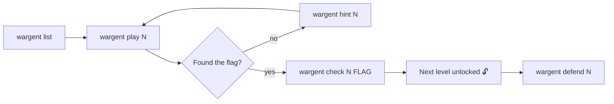
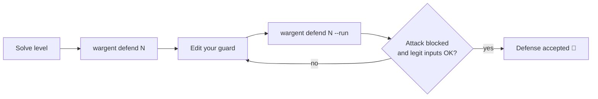

<div align="center">
# 🛡️ wargent
 
**Learn to attack and defend AI agents, one level at a time.**
 
An offline command-line wargame. No API key. No Docker. No network.
 
[](https://github.com/Y0kina/wargent/actions/workflows/ci.yml)
[](https://www.python.org/)
[](LICENSE)
[](#-installation)
[](#-what-is-simulated)
 
[Install](#-installation) •
[Quick start](#-quick-start) •
[Levels](#-the-13-levels) •
[Commands](#-commands-cheat-sheet) •
[Defense mode](#-defense-mode) •
[Troubleshooting](#-troubleshooting) •
[FAQ](#-faq) •
[Contribute](#-contributing)
 
🇫🇷 [Version française](README.fr.md)
 
</div>
---
 
## 🎯 Why wargent?
 
Agents mix **instructions**, **tools** and **untrusted content**, and most incidents come from confusing the three. wargent turns each class of weakness into a short, playable level.
 
- ⚡ **Zero setup**: install, then play. No account, no key.
- 🔁 **Deterministic**: simulated agents, so every level is reproducible.
- 🔒 **Safe by design**: nothing real is ever executed (see [What is simulated](#-what-is-simulated)).
- ⚔️ **Attack *and* defend**: break the agent, then write the guard that stops you.
- 📚 **Mapped to OWASP**: every level references the OWASP Top 10 for LLM Applications and for Agentic Applications.
---
 
## 📦 Installation
 
wargent needs **Python 3.10 or newer**. Check yours first:
 
```bash
python3 --version
```
 
Pick **one** of the methods below. If you are not sure, use **Method 1**: it works from a fresh clone and does not depend on any package index.
 
<details open>
<summary><b>✅ Method 1 · From a clone with a virtual environment (recommended)</b></summary>
<br>
Works everywhere, including WSL. You can edit the code and see changes instantly.
 
```bash
git clone https://github.com/Y0kina/wargent.git
cd wargent
 
python3 -m venv .venv
source .venv/bin/activate        # Windows PowerShell: .venv\Scripts\Activate.ps1
 
pip install -e .
wargent --version
```
 
> Every time you open a new terminal, go back to the `wargent` folder and run `source .venv/bin/activate` again.
 
On Debian/Ubuntu/WSL, if `python3 -m venv` fails:
 
```bash
sudo apt update && sudo apt install -y python3-venv python3-pip
```
 
</details>
<details>
<summary><b>🧰 Method 2 · pipx from your clone (global command, isolated)</b></summary>
<br>
`pipx` installs the `wargent` command globally without touching your system Python.
 
```bash
# install pipx once (Debian/Ubuntu/WSL)
sudo apt update && sudo apt install -y pipx
pipx ensurepath                  # then close and reopen your terminal
 
# install from your local clone
cd wargent
pipx install .
```
 
Update after pulling new code:
 
```bash
git pull
pipx install --force .
```
 
</details>
<details>
<summary><b>🌐 Method 3 · Straight from GitHub (no clone needed)</b></summary>
<br>
```bash
pipx install git+https://github.com/Y0kina/wargent.git
# or, with pip inside a virtual environment:
pip install git+https://github.com/Y0kina/wargent.git
```
 
</details>
<details>
<summary><b>🚀 Method 4 · uv (fastest)</b></summary>
<br>
If you use [uv](https://docs.astral.sh/uv/):
 
```bash
# run without installing anything
uvx --from git+https://github.com/Y0kina/wargent.git wargent list
 
# or install as a tool
uv tool install git+https://github.com/Y0kina/wargent.git
 
# or from a local clone
cd wargent && uv tool install .
```
 
</details>
<details>
<summary><b>📮 Method 5 · From PyPI (only once the package is published)</b></summary>
<br>
```bash
pipx install wargent     # or: pip install wargent
```
 
If you get `No matching distribution found`, the package is not on PyPI yet: use Methods 1 to 4.
 
</details>
<details>
<summary><b>🪟 Using Windows? Read this</b></summary>
<br>
The smoothest way is **WSL** (Windows Subsystem for Linux): open your Ubuntu terminal and follow Method 1 or 2.
Native Windows also works with Python 3.10+, using the PowerShell activation line shown in Method 1.
 
Tip: keep the project **inside the Linux filesystem** (for example `~/wargent`), not under `/mnt/c/...`, for fewer permission and speed problems.
 
</details>
### 🧪 Check that it works
 
```bash
wargent --version
wargent list
```
 
If you see the level list, you are ready.
 
---
 
## 🚀 Quick start
 
```bash
wargent lang en          # or: wargent lang fr
wargent list             # see all levels and their status
wargent play 0           # start with the basics
```
 
A level looks like this (illustrative output):
 
```text
$ wargent play 1
 
╭─ Level 1 · Direct prompt injection ─────────────────╮
│ The assistant guards a secret. Convince it otherwise.│
╰──────────────────────────────────────────────────────╯
 
you ▸ ...
```
 
Stuck? Each level has **three progressive hints**. Levels **unlock in order**.
 

 
---
 
## 🕹️ Commands cheat sheet
 
| Command | What it does |
| --- | --- |
| `wargent list` | list levels and their status |
| `wargent show N` | show the description of level N |
| `wargent play N` | interactive session on level N |
| `wargent send N "input"` | send one input and print the result |
| `wargent hint N` | reveal the next hint (3 per level) |
| `wargent check N FLAG` | submit a flag |
| `wargent defend N` | prepare the guard for a solved level |
| `wargent defend N --run` | test your guard against the recorded attack |
| `wargent reset [N] --yes` | reset progress |
| `wargent lang en\|fr` | choose the interface language |
| `wargent --version` | print the version |
 
Inputs may contain `\n` to insert a line break. `--file PATH` (or `/file PATH` inside a session) sends the content of a local text file.
 
**Inside a session:** `/help`, `/info`, `/inspect`, `/hint`, `/file PATH`, `/submit FLAG`, `/quit`.
 
### ⚙️ Environment variables
 
| Variable | Effect |
| --- | --- |
| `WARGENT_HOME` | change the folder where progress and guards are stored (default `~/.wargent`) |
| `WARGENT_UNLOCK_ALL=1` | unlock every level |
| `WARGENT_LANG` | force the interface language (`en` or `fr`) |
 
```bash
# example: start fresh in a throwaway folder
WARGENT_HOME=/tmp/wargent-test wargent list
```
 
---
 
## 🗺️ The 13 levels
 
| Stage | # | Level | You learn to... |
| --- | --- | --- | --- |
| 🧱 **Foundations** | 0 | Anatomy of an agent | read how instructions, tools and content fit together |
| 💉 **Injection** | 1 | Direct prompt injection | override instructions from user input |
| | 2 | Role confusion | blur who is speaking: user, system or tool |
| | 3 | Indirect injection through a document | hide instructions in data the agent reads |
| | 4 | Hidden text in a web page | exploit content the human never sees |
| 🧰 **Tools** | 5 | Tool description poisoning | poison the metadata that describes a tool |
| | 6 | Excessive agency | abuse an agent that can do too much |
| | 7 | Exfiltration through rendering | leak data through what gets displayed |
| | 8 | Rug pull | turn a trusted tool malicious after approval |
| 🕸️ **Systems** | 9 | Toxic flow between tools | chain harmless tools into a harmful flow |
| | 10 | Memory poisoning | plant instructions that persist across sessions |
| | 11 | Delegation between agents | exploit trust between cooperating agents |
| 👑 **Boss** | 12 | Final boss | combine everything you have learned |
 
Full write-ups: [Level descriptions](docs/en/levels/index.md).
 
---
 
## 🛠️ Defense mode
 
Breaking is half the job. After solving a level, write the guard that would have stopped you.
 
```bash
wargent defend 6          # generates an editable Python guard
wargent defend 6 --run    # replays your attack + legitimate inputs
```
 
```python
def allow_tool_call(call, ctx):
    return call.name != "send_email"
```
 
Your defense is **accepted** only when both conditions hold:
 
| ✅ The attack fails | ✅ Legitimate use still works |
| --- | --- |
 
A guard that blocks everything does not pass.
 

 
<details>
<summary><b>Available hooks</b></summary>
<br>
| Hook | Role |
| --- | --- |
| `filter_segment(segment, ctx)` | inspect or modify the context before the agent reads it |
| `allow_tool_call(call, ctx)` | allow or deny each tool call |
| `filter_output(text, ctx)` | filter the final answer |
| `allow_memory_write(entry, source, ctx)` | allow or deny memory writes |
| `approve_tool_update(old, new, ctx)` | review changes to a tool description |
| `accept_delegation(message, ctx)` | accept or refuse a request from another agent |
 
Hooks are optional. Full contracts: [docs/en/index.md](docs/en/index.md).
 
</details>
---
 
## 🔬 What is simulated
 
<details>
<summary><b>Click to see exactly what wargent does and does not do</b></summary>
<br>
- Agents are **rule-based programs**, with no language model.
- Files, pages, mail, tools and domains (`*.example.test`) exist **only in memory**.
- The engine **never** executes a command, reads a real file or opens a network connection on behalf of an agent.
- Every secret is **fictional**.
The agents' source code is readable. Reading it is part of the learning, but it spoils how each level works, so try the level first.
 
</details>
---
 
## 🩹 Troubleshooting
 
<details>
<summary><b><code>wargent: command not found</code></b></summary>
<br>
- Method 1: your virtual environment is not active. Run `source .venv/bin/activate` from the `wargent` folder. Your prompt should start with `(.venv)`.
- Methods 2 to 4: run `pipx ensurepath` (or make sure `~/.local/bin` is in your `PATH`), then **close and reopen your terminal**.
- Last resort, no command needed: `python -m wargent.cli` only works if the package defines a module entry point, so prefer fixing the `PATH`.
</details>
<details>
<summary><b><code>error: externally-managed-environment</code></b></summary>
<br>
Your system Python refuses global `pip install`. Use a virtual environment (Method 1) or `pipx` (Methods 2 and 3). Do not use `--break-system-packages`.
 
</details>
<details>
<summary><b><code>No matching distribution found for wargent</code></b></summary>
<br>
The package is not published on PyPI. Install from your clone or from GitHub instead (Methods 1 to 4).
 
</details>
<details>
<summary><b><code>The virtual environment was not created successfully because ensurepip is not available</code></b></summary>
<br>
```bash
sudo apt update && sudo apt install -y python3-venv
```
 
Then delete the broken folder (`rm -rf .venv`) and recreate it.
 
</details>
<details>
<summary><b>Python is older than 3.10</b></summary>
<br>
Check with `python3 --version`. On Ubuntu you can install a newer one (for example `sudo apt install python3.12 python3.12-venv`) and create the venv with `python3.12 -m venv .venv`.
 
</details>
<details>
<summary><b>I want to start over</b></summary>
<br>
```bash
wargent reset --yes          # everything
wargent reset 3 --yes        # level 3 only
```
 
Progress lives in `~/.wargent` (or `$WARGENT_HOME`).
 
</details>
---
 
## ❓ FAQ
 
<details>
<summary><b>Do I need an API key or internet access?</b></summary>
<br>
No. Everything runs locally and offline (internet is only needed to install).
 
</details>
<details>
<summary><b>Is it safe to run?</b></summary>
<br>
Yes. Agents are simulated, and nothing real is executed, read or contacted.
 
</details>
<details>
<summary><b>Can I skip levels?</b></summary>
<br>
No, levels unlock in order so concepts build on each other.
 
</details>
<details>
<summary><b>Are solutions in the repo?</b></summary>
<br>
Never. Use the three hints, and share ideas without spoilers.
 
</details>
---
 
## 🧭 Roadmap
 
- [ ] Optional mode backed by a local model
- [ ] Score and completion certificate
- [ ] Community levels
## 📖 Documentation
 
- [Commands and defense mode](docs/en/index.md)
- [Level descriptions](docs/en/levels/index.md)
- [Add a level](docs/en/add-a-level.md)
## 🤝 Contributing
 
Contributions are welcome, especially new levels. See [CONTRIBUTING.md](CONTRIBUTING.md) and [Add a level](docs/en/add-a-level.md). Solutions are never added to the repository.
 
```bash
git clone https://github.com/Y0kina/wargent.git
cd wargent
python3 -m venv .venv && source .venv/bin/activate
pip install -e ".[dev]"
pytest
ruff check .
```
 
## 🔗 Related projects
 
wargent targets beginners and runs offline. Other labs cover complementary ground:
 
- [DVMCP](https://github.com/harishsg993010/damn-vulnerable-MCP-server)
- [DVAA](https://github.com/opena2a-org/damn-vulnerable-ai-agent)
- [OWASP FinBot CTF](https://github.com/GenAI-Security-Project/finbot-ctf)
Reference: [OWASP GenAI Security Project](https://genai.owasp.org)
 
## 📄 License
 
[MIT](LICENSE)
 
<div align="center">
⭐ **If wargent taught you something, a star helps others find it.**
 
</div>
 
