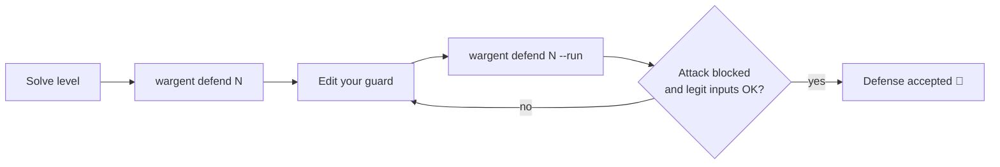

<div align="center">
# 🛡️ wargent
 
**Learn to attack and defend AI agents, one level at a time.**
 
An offline command-line wargame. No API key. No Docker. No network.
 
[](https://github.com/Y0kina/wargent/actions/workflows/ci.yml)
[](https://pypi.org/project/wargent/)
[](https://pypi.org/project/wargent/)
[](LICENSE)
 
[Quick start](#-quick-start) •
[Levels](#-the-13-levels) •
[Defense mode](#-defense-mode) •
[FAQ](#-faq) •
[Contribute](#-contributing)
 
🇫🇷 [Version française](README.fr.md)
 
</div>
---
 
## 🎯 Why wargent?
 
Agents mix **instructions**, **tools** and **untrusted content**, and most incidents come from confusing the three. wargent turns each class of weakness into a short, playable level.
 
- ⚡ **Zero setup**: one `pipx install` and you are playing.
- 🔁 **Deterministic**: simulated agents, so every level is reproducible.
- 🔒 **Safe by design**: nothing real is ever executed (see [What is simulated](#-what-is-simulated)).
- ⚔️ **Attack *and* defend**: break the agent, then write the guard that stops you.
- 📚 **Mapped to OWASP**: every level references the OWASP Top 10 for LLM Applications and for Agentic Applications.
## 🚀 Quick start
 
```bash
pipx install wargent     # or: pip install wargent
wargent list             # see all levels
wargent play 0           # start with the basics
```
 
> Requires Python 3.10+.
 
A level looks like this (illustrative output):
 
```text
$ wargent play 1
 
╭─ Level 1 · Direct prompt injection ─────────────────╮
│ The assistant guards a secret. Convince it otherwise.│
╰──────────────────────────────────────────────────────╯
 
you ▸ ...
```
 
Stuck? Each level has **three progressive hints**. Levels **unlock in order**.
 
## 🗺️ The 13 levels
 
| Stage | # | Level | You learn to... |
| --- | --- | --- | --- |
| 🧱 **Foundations** | 0 | Anatomy of an agent | read how instructions, tools and content fit together |
| 💉 **Injection** | 1 | Direct prompt injection | override instructions from user input |
| | 2 | Role confusion | blur who is speaking: user, system or tool |
| | 3 | Indirect injection through a document | hide instructions in data the agent reads |
| | 4 | Hidden text in a web page | exploit content the human never sees |
| 🧰 **Tools** | 5 | Tool description poisoning | poison the metadata that describes a tool |
| | 6 | Excessive agency | abuse an agent that can do too much |
| | 7 | Exfiltration through rendering | leak data through what gets displayed |
| | 8 | Rug pull | turn a trusted tool malicious after approval |
| 🕸️ **Systems** | 9 | Toxic flow between tools | chain harmless tools into a harmful flow |
| | 10 | Memory poisoning | plant instructions that persist across sessions |
| | 11 | Delegation between agents | exploit trust between cooperating agents |
| 👑 **Boss** | 12 | Final boss | combine everything you have learned |
 
Full write-ups: [Level descriptions](docs/en/levels/index.md).
 
## 🛠️ Defense mode
 
Breaking is half the job. After solving a level, write the guard that would have stopped you.
 
```bash
wargent defend 6          # generates an editable Python guard
wargent defend 6 --run    # replays your attack + legitimate inputs
```
 
```python
def allow_tool_call(call, ctx):
    return call.name != "send_email"
```
 
Your defense is **accepted** only when both conditions hold:
 
| ✅ The attack fails | ✅ Legitimate use still works |
| --- | --- |
 
A guard that blocks everything does not pass. Hooks and contracts: [docs/en/index.md](docs/en/index.md).
 

 
## 🔬 What is simulated
 
<details>
<summary><b>Click to see exactly what wargent does and does not do</b></summary>
<br>
- Agents are **rule-based programs**, with no language model.
- Files, pages, mail, tools and domains (`*.example.test`) exist **only in memory**.
- The engine **never** executes a command, reads a real file or opens a network connection on behalf of an agent.
- Every secret is **fictional**.
The agents' source code is readable. Reading it is part of the learning, but it spoils how each level works, so try the level first.
 
</details>
## ❓ FAQ
 
<details>
<summary><b>Do I need an API key or internet access?</b></summary>
<br>
No. Everything runs locally and offline.
</details>
<details>
<summary><b>Is it safe to run?</b></summary>
<br>
Yes. Agents are simulated, and nothing real is executed, read or contacted.
</details>
<details>
<summary><b>Can I skip levels?</b></summary>
<br>
No, levels unlock in order so concepts build on each other.
</details>
<details>
<summary><b>Are solutions in the repo?</b></summary>
<br>
Never. Use the three hints, and share ideas without spoilers.
</details>
## 🧭 Roadmap
 
- [ ] Optional mode backed by a local model
- [ ] Score and completion certificate
- [ ] Community levels
## 📖 Documentation
 
- [Commands and defense mode](docs/en/index.md)
- [Level descriptions](docs/en/levels/index.md)
- [Add a level](docs/en/add-a-level.md)
## 🤝 Contributing
 
Contributions are welcome, especially new levels. See [CONTRIBUTING.md](CONTRIBUTING.md) and [Add a level](docs/en/add-a-level.md). Solutions are never added to the repository.
 
## 🔗 Related projects
 
wargent targets beginners and runs offline. Other labs cover complementary ground:
 
- [DVMCP](https://github.com/harishsg993010/damn-vulnerable-MCP-server)
- [DVAA](https://github.com/opena2a-org/damn-vulnerable-ai-agent)
- [OWASP FinBot CTF](https://github.com/GenAI-Security-Project/finbot-ctf)
Reference: [OWASP GenAI Security Project](https://genai.owasp.org)
 
## 📄 License
 
[MIT](LICENSE)
 
<div align="center">
⭐ **If wargent taught you something, a star helps others find it.**
 
</div>
